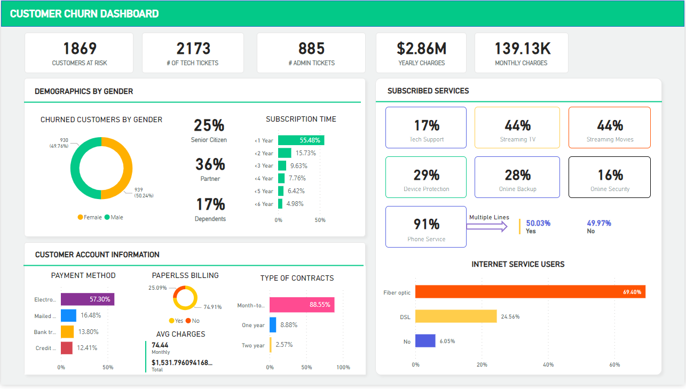
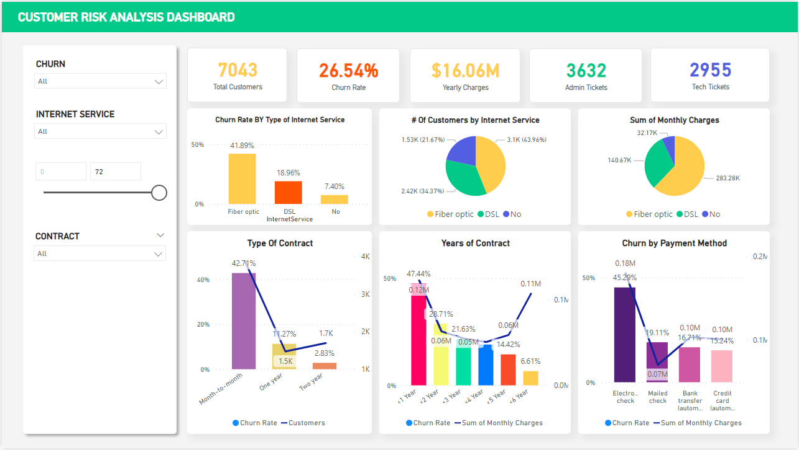

# Customer Churn Analytics

[](https://github.com/aparnaa-shanmuganathan/churn-analysis/actions/workflows/ci.yml)

An interactive **Streamlit** web app that rebuilds two Power BI churn dashboards for a telecom
customer base (7,043 customers). It also adds a churn-prediction model that ranks active
customers by their risk of leaving.

| Page | What it answers |
|---|---|
| **Overview** | Headline KPIs and auto-generated key insights |
| **Churned Customer Profile** | Who left: demographics, services, billing (Power BI page 1) |
| **Risk Analysis** | Where churn concentrates: contract, internet, tenure, payment (Power BI page 2) |
| **Churn Prediction** | Logistic-regression model, drivers, downloadable at-risk customer list |
| **Data Explorer** | Filtered dataset, CSV download and data dictionary |

Sidebar filters (churn, internet service, contract, tenure) work like the Power BI slicers
and apply to every page.

## Key findings

- Month-to-month customers churn at **42.7%**, compared with **2.8%** on two-year contracts.
- **47%** of customers in their first year churn, and 55% of all churners leave within 12 months.
- Fiber-optic customers churn at **41.9%**, the highest of any internet type, even though they bring in the most revenue.
- Electronic-check payers churn at **45.3%**. Customers on automatic payments churn at 15–17%.

## Improvements over the Power BI version

| Power BI | Streamlit app |
|---|---|
| Needs Power BI Desktop to view | Runs in any browser; deployable with a public URL |
| Dual-axis combo charts (rate + volume on two scales) | Rate and volume in side-by-side charts with one axis each, so neither is misread |
| Pie and donut charts | Sorted bar charts, which compare shares more accurately |
| Different colours on each visual | One palette; churned and retained use the same colours on every page |
| Descriptive only | Churn model (ROC AUC ~0.93) plus a ranked, downloadable at-risk list |
| Measures hidden in the .pbix | KPI logic in tested Python (`src/`); tests check that the numbers match the Power BI report exactly |
| Blank `TotalCharges` handled implicitly | Explicit, logged cleaning rule (tenure-0 customers → 0) |

## Project structure

```
├── streamlit_app.py          # entry point: navigation + shared filters
├── app/
│   ├── common.py             # caching, sidebar slicers, KPI cards
│   └── views/                # one file per page
├── src/churn_dashboard/
│   ├── data.py               # load, validate, clean, filter
│   ├── metrics.py            # KPIs / aggregations (the "DAX measures")
│   ├── charts.py             # Plotly figure builders, one visual system
│   └── model.py              # scikit-learn pipeline + evaluation
├── tests/                    # pytest: data rules, KPI parity with Power BI, model, page smoke tests
├── data/telco_churn.csv      # dataset (converted from the Power BI Excel source)
├── powerbi/                  # original .pbix reports
├── docs/images/              # Power BI screenshots
├── archive/v1-bankchurners-eda/   # first version of this repo (EDA notebook), history preserved
├── Dockerfile
└── .github/workflows/ci.yml  # ruff + pytest on every push / PR
```

## Run locally

```bash
python -m venv .venv && source .venv/bin/activate
pip install -r requirements-dev.txt
streamlit run streamlit_app.py      # http://localhost:8501
pytest -q && ruff check .
```

### Docker

```bash
docker build -t churn-dashboard .
docker run -p 8501:8501 churn-dashboard
```

## Deploy (free) on Streamlit Community Cloud

1. Push this repo to GitHub.
2. Go to <https://share.streamlit.io> and click **Create app**, then choose this repo, branch `main`, main file `streamlit_app.py`.
3. Deploy. Every push to `main` redeploys automatically.

The Docker image runs unchanged on Render, Railway, Google Cloud Run or Azure Container Apps.
It includes a health check at `/_stcore/health`.

## Project history

- **v1**: EDA notebook on the BankChurners credit-card dataset → [`archive/v1-bankchurners-eda`](archive/v1-bankchurners-eda) (git tag `v1-bankchurners-eda`)
- **v2**: Power BI dashboards → [`powerbi/`](powerbi)
- **v3**: this Streamlit app

<details>
<summary>Original Power BI dashboards</summary>



</details>

## Notes and limitations

- Support-ticket counts are the strongest model signal. In production, check that ticket data is
  available *before* the churn event so the model does not learn from information it would not
  have at prediction time.
- Active customers are scored by a model trained on the same population. Use the
  probabilities for ranking, and retrain on new data with a time-based split before acting on
  exact values.
